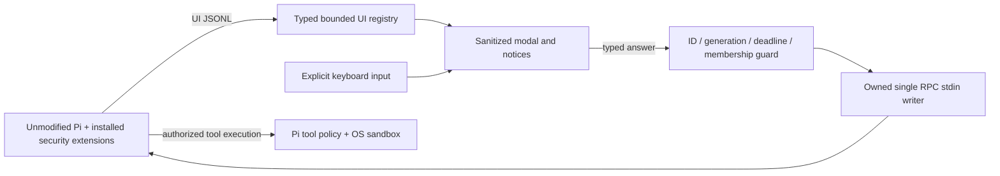

> HISTORICAL P03 record. Superseded by approved P03.1 scope; not current requirements or recommendations.

# Security boundary and P03 evidence

Verified 2026-11-16, Linux, Pi1.5.2. G1 PARTIAL; this is not production/security certification.

Pi alone decides authorization and executes tools. Rust never evaluates option
meanings, grants filesystem access, retries denied writes or launches a host
shell. The normal command API still rejects direct bash and raw
extension_ui_response; typed UI replies use a separate one-way path with the
exact backend ID, no request-ID rewriting and no command response waiter.

All dialogs interrupt normal input. Select has no implicit selection; confirm
requires plain y or n, not modified shortcuts or Enter. Escape cancels; Ctrl+G
in the demo invalidates pending dialogs and sends Pi abort. Ctrl+C exits and
reaps Pi. Existing draft/focus are restored; backend editor replacements are
staged when an unsent draft exists. Raw option values remain unchanged for
replies; only rendered text is sanitized. No ANSI/OSC supplied by a backend is
written directly to the terminal. Title is shown in-app rather than emitted as
OSC; widgets are bounded string lines, not executable components.

Limits: 32 outstanding dialogs; 1,024 interactive IDs/tombstones per connection
(reset/reconnect required at exhaustion); 64 options or widget lines; 8 KiB
strings; 32 status/widget keys and recent notices. Fire-and-forget IDs are not
retained. Timeout is a positive integer up to one day. Malformed/unsupported
UI requests invalidate pending dialogs and mark health desynchronized.
Responses are checked again in the writer; canceled acknowledgment receivers
discard unsent tickets. Registry Consumed is an irrevocable writer commitment,
not an assertion that Pi accepted or authorized anything. Oversized responses
are rejected before IO. Shutdown/crash/abort/session controls invalidate stale
requests. All process/task lifetime limitations from P02 still apply.

## Protocol limits

Pi starts dialog timers before emitting requests. It sends no cancellation
event when timeout or AbortSignal resolves a dialog. The frontend checks its
receipt-based deadlines and invalidates on settlement, explicit abort/session
controls, malformed streams and disconnect; it cannot know an unseen backend
resolution at the exact instant it occurs. Pi drops replies for resolved IDs.
There is no extension-origin or permission-critical field on the wire: every
dialog receives priority, distinct global statusKey/widgetKey entries remain
separate, and same-key collisions cannot be attributed/prevented here.

## Real isolated fixture

Run the exact G1 command in IMPLEMENTATION-STATUS.md. Source packages are loaded
from the explicitly supplied installed package directory without modification.
All settings, fake model configuration, permission rules, generated auth stores,
markers and symlinks live in a freshly created private /tmp/pi-visual-g1-* root.
HOME, PI_CODING_AGENT_DIR, XDG config/cache and cwd point there; environment is
cleared and PI_OFFLINE=1. Explicit -e loads the real packages despite discovery
being disabled. No policies are copied from live config. A local HTTP provider
emits deterministic tool calls; there is no model, paid provider or real key.
Bash test commands are sent as model tool arguments to Pi; the frontend never
executes them. The test server executes no shell.

24 cases verify sandbox and permission packages separately and together,
including positive bash controls, deny-over-allow, symlink/canonical paths,
traversal, denial/cancellation/timeout and once-only explicit allowed writes.
Every actual rejected operation requires isError AND unchanged file contents.
The script never falls back to an unsandboxed tool when rejection occurs.
No emergency host override or persistent grant is used. Temporary evidence
roots are retained; clean them up manually after review.

Sandbox protection applies to the configured Pi tool calls. It does not wrap
every Rust process, test server or future browser. Browser execution remains
disabled; its independent isolation work is outside P03.

## Acceptance blocker

pi-sandbox0.8.2 intentionally aborts access grants outside native TUI mode.
The permission package42.0.0 supports select/input RPC fallback. Real denials
and that fallback pass, but sandbox native-widget parity does not. G1 is
PARTIAL by the master acceptance rule; P03 is not complete. See
compatibility-gaps.md. Four-mode/emergency configurations, real Kitty/IME,
advisory audits and broad security certification remain NOT TESTED.
