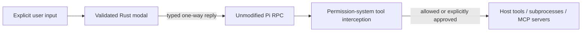

# Security — revised P03.1 permission-interception boundary

Scope approved 2026-11-16: @gotgenes/pi-permission-system (tested42.0.0), or a
separately approved future replacement. No pi-sandbox production requirement,
installation, integration fork or native-widget compatibility work is planned.
Revised G1 PASS is narrow interception evidence, not security certification.
See ADR0002 for criteria and the original removed requirements.

There is deliberately NO OS-confinement box after the gate. Pi owns permission
policy and tools; Rust has no extra host-shell path or independent permission
engine. Direct frontend bash remains disabled. Once a program or MCP operation
is allowed, its downstream effects are not mediated by this frontend.

## Remaining tested guarantees

- Correct typed select/confirm/input/editor/cancel shapes and exact request IDs;
  raw option fidelity; no automatic affirmative default or incidental shortcut.
- Conservative bounded registry, stale/duplicate/malformed handling, final writer
  dispatch checks, canceled unsent replies, timeout/abort/session/disconnect
  invalidation and preservation of draft/focus; all prior P02/P03 tests retained.
- Actual package policy outcomes for builtin reads/writes, visible Bash operands,
  external_directory read/write rules, static symlinks, traversal and simulated
  sensitive paths. Every denied tested operation reports rejection and preserves
  the marker, with no retry/fallback route.
- Supported RPC human decision flow (single select, not native double-confirm).
  Once approval, repeated session approval, denied path despite a session grant,
  cancellation, timeout and fresh-process reset are tested with real Pi.
- Actual builtin MCP + stdio server tool dispatch is intercepted: policy/path
  denials do not reach the server; approved/allowed operations do. Server receipt
  files independently corroborate execution, not just rendered error text.
- Disposable fixture HOME/config/cwd/XDG roots, cleared environment, PI_OFFLINE,
  loopback fake provider and no real credentials, paid inference or live policy
  modifications. No production tools were installed by these tests.

Glob matching in a category follows package rule ordering; a configured deny
is not an immutable OS ACL. Tests prove outcomes of the stated composed policy,
not that every deny string defeats any later rule. Symlinks are resolved before
execution with the package's best-effort canonicalization, not race-free handles.

## Removed / explicitly absent guarantees

No OS-level filesystem, process or network isolation is claimed for Pi's tools,
approved scripts, extensions, MCP servers, Rust or future browsers. No guarantee
that a denied path remains inaccessible to already authorized opaque code. No
sandbox grant widget, combined-sandbox requirement or compatibility fork. These
protections were removed from the production contract, not replaced equivalently.
Browser execution stays disabled until its separate isolation design is proven.

Adversarial evidence: approved Python and shell scripts derive an outside path
internally and change a marker whose path_write policy remains deny. An allowed
opaque MCP tool with no path argument does the same. Rejecting these tools leaves
markers unchanged. The test server's root-only guard is fixture host protection,
not product containment. Approving an interpreter or trusting an MCP server is
therefore broader authority than authorizing an inspectable direct write.
The gate does not isolate production credentials, host environment, network or
private files from already authorized code running with the same OS user. The
cleared test environment is fixture hygiene, not a production confinement proof.

## Protocol limits retained

Pi starts timeout before emitting a request and sends no cancel event when its
pending UI resolves. Rust cannot know an unreported backend resolution at the
same instant; its local deadline/dispatch guards and Pi's ignored stale IDs are
not a distributed revocation protocol. After writer commitment, bytes cannot be
recalled. UI state Consumed is commitment, not backend receipt or authorization.

All dialogs get priority: there is no permission tag or extension identity on
this wire. Distinct statusKey/widgetKey values remain separate; ownership of a
same-key collision cannot be attributed. UI text is sanitized rather than emitted
as arbitrary ANSI/OSC. Widgets are text lines, titles are in-app, backend editor
replacements are staged when a draft exists. Native UI parity is not implied.

Bounds remain 32 outstanding dialogs,1024 interactive IDs per connection,64
options/widget lines,8KiB strings,32 keys/recent notices; fire-and-forget IDs do
not consume dialog replay IDs. Explicit shutdown is required before runtime
teardown. Process groups provide lifecycle cleanup, not confinement.

## Modes and emergency access

No approved four-mode definitions/implementation or exact emergency override
workflow were found in the repository or installed schema. The master made
four-mode testing conditional on configuration; this does not supply missing
semantics. Verified policies are allow/ask/deny; yoloMode stayed false. YOLO
would autoapprove asks and is NOT a separately confirmed emergency mechanism.
No four-mode or emergency certification is included in revised G1.

## Reproduction and history

Run commands in IMPLEMENTATION-STATUS.md. Current g1.rs explicitly loads only
permission-system plus builtin MCP for its MCP cases. No sandbox config is
created. All artifacts are under fresh private /tmp/pi-visual-g1-* roots and are
retained for review. Archived original24-case suite is g1_legacy_sandbox.rs;
original criteria/results remain docs/history/P03-original-*. Archived files
are records, not instructions to reintroduce a sandbox dependency.

Remote/deferred/codemode MCP adapters, symlink-race protection, real Kitty/IME,
OS network containment, external security audits and production resource limits
remain outside this demonstrated boundary.

## P04 terminal consumer boundary

P04 preserves P03 registry/writer authority and adds no permission engine or host
tool executor. Every dialog suspends transcript/draft routing. Paste is allowed
only in input/editor dialogs and never becomes a confirm/select answer. Disconnection
invalidates dialogs and disables frontend submissions; stale writer replies remain
rejected. Draw uses prepared sanitized text without locks or RPC requests.

Explicit replay imports canonicalize paths, deny known credential/config roots and
names, open nonblocking, verify the opened descriptor target and regular-file
metadata, and bound reads16MiB. This is a read-only importer for user-selected
records, not a universal classifier of private data: renamed sensitive files can
still be selected deliberately. No automatic project scanning, image/fence execution,
clipboard OSC, link opener, browser or provider calls are added.

The disposable UI fixture path disables discovery/tools and loads only the reviewed
UI fixture. It is not the normal production startup path and must never replace
live backend security settings. G1 still means permission interception only:
approved subprocesses/MCP remain capable of host effects. pi-sandbox is not required.
Normal user-config startup, real Kitty, IME, OS isolation, browser confinement and
full dependency advisory audit remain unverified. SIGKILL cannot restore terminals.

## P04.1 normal startup and explicit recovery

Normal startup now retains Pi configuration/extension discovery and its ordinary
environment; there is no frontend auth-store parser, tool executor or shell route.
Automatic startup requests are state/history reads only. Tests never start against
live config: they create private HOME/agent/project roots, set PI_OFFLINE and use
synthetic histories. G0/G1 retain their loopback-only fake-provider fixtures.

Session navigation uses public RPC and preserves backend veto/deny authority.
A response boundary prevents old buffered message/tool prefixes entering another
session. Unknown transition outcomes disable submissions; explicit restart joins
old jobs/reaps the dedicated child, then rehydrates via Pi. Completion generation
and transport health prevent a late history response falsely declaring readiness.
The Rust frontend never retries a denied tool or accepted prompt. Normal Pi may
perform its own authorized session persistence; developer tests do not touch live
session files. Permission interception still does not provide OS/network isolation.

The normal-startup PTY fixture demonstrates discovery of its reviewed veto extension,
not production permission enforcement. Keep that claim tied to revised G1. Unknown
raw notices are bounded8MiB separately and sanitized on display; F3 never executes
content. Kitty configs, opacity, remote-control policy and browser remain untouched.

## P04.2 untrusted ANSI text

The shared display_text boundary now strips whole escape/control sequences rather
than deleting ESC alone. A constant-state,linear scanner removes SGR and unsupported
CSI,OSC/DCS/SOS/PM/APC and ESC intermediate/C1 forms. Backend styles are not executed
or emulated; existing Ratatui semantic styling remains. Raw strings are retained in
UiState/workflow data and exact raw selection values are returned only upon explicit
input. Empty/colliding sanitized selection labels invalidate the UI request.

Parser state is local to one complete value. It cannot carry an unfinished OSC
from one status into another extension/dialog. Unterminated sequences are discarded
to value end; malformed CSI recovery preserves safe newline/non-ASCII text. Plain
literal bracket text remains literal. This does not protect against every Unicode
homoglyph/visual-confusability attack; the existing bidi removal remains in scope.

Tests cover sequence fragments after raw message reconstruction,fragmented JSONL,
controls and clipboard/title/navigation escape attempts,permission option ambiguity,
status replacement and inert historical /quit. No raw backend ANSI reaches a TTY.
These tests are distinct from human genuine Kitty interaction and from G1's actual
permission interception. No production policy or installed package was changed.
